# The Blutils Online Viewer

`Blutils` provides an online viewer to explore the consensus taxonomic
identities of a run. It is a client-side application that runs entirely in the
browser: your result file is read locally and **never leaves your computer**.

## Accessing the viewer

Open the viewer at:

```bash
https://lepistabioinformatics.github.io/blutils-ui/
```

## Opening a result

Choose the `blutils.consensus.json` file produced by your run and click **View
results**. To try the viewer without a file of your own, click **Load a sample
dataset**. It opens the ZymoBIOMICS mock community ITS run, classified with the
relaxed strategy, from the Blutils benchmark.

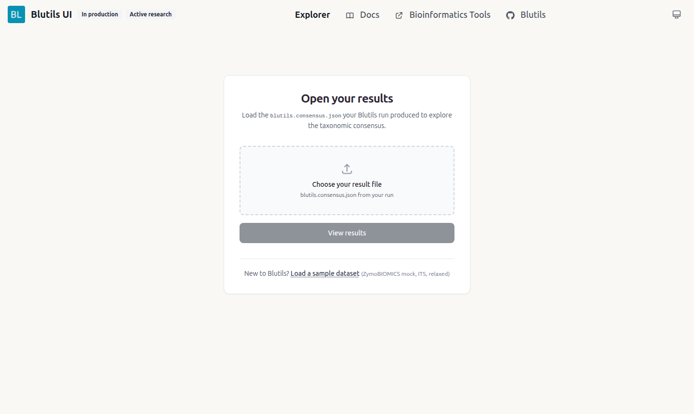

A result can also be opened from a link: add `?p=<url of a result file>` to the
viewer address. The current view, group and filter are kept in the address too
(`?v=`, `?g=`, `?f=`), so a link brings anyone back to exactly what you are
looking at.

While a result is open, **Reset** (top right, in the navigation bar) closes it
and returns to this screen.

## The record list

Each record is one entry in the list. The columns line up across entries, so
values are easy to compare:

- **Query**: the sequence name. Below it you see the rank that was reached
  and the full lineage.
- **Proposed taxon**: the consensus taxon at the reached rank. When it
  differs, the most probable consensus bean is shown below it.
- **Rule**: how the proposed taxon was chosen, as a single word (see the
  Rules section below).
- **Composition**: identity (%) and bit score, with a bar of the consensus
  beans below them. Each block is one candidate taxon, sized by its
  occurrences. Hover a block to see its name.

The list scrolls inside the page, so all the records are always one scroll
away; there are no pages to click through.

Click anywhere on a record (except its rule) to open its details. With the
keyboard, **↑** and **↓** move through the records and **Enter** opens the
highlighted one.

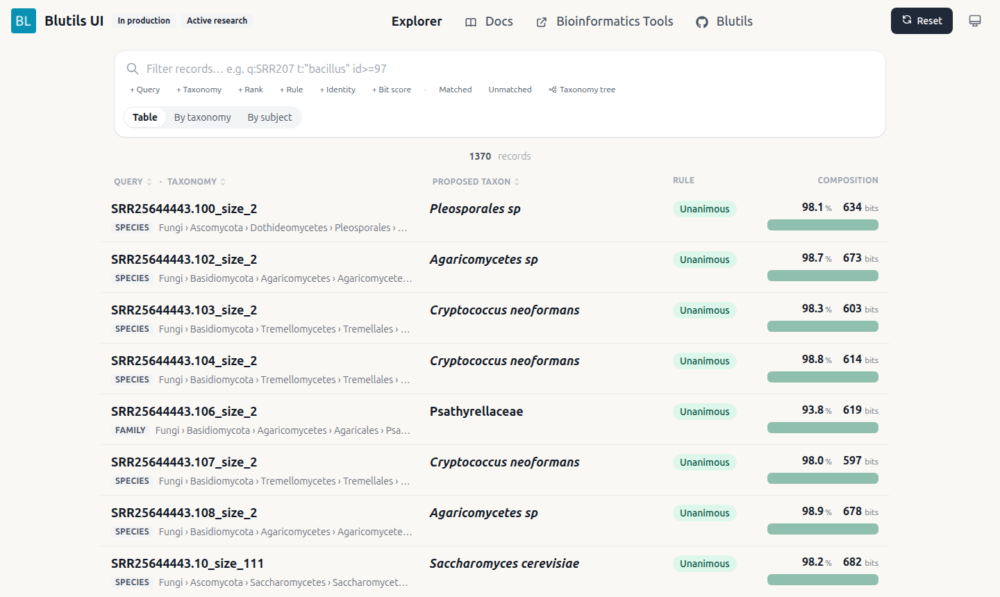

### Sorting

Click **Query**, **Taxonomy** or **Proposed taxon** in the column header to
sort. Each click goes ascending, then descending, then back to the original
order of the file. While a sort is active, the **Original order** button
restores the file order at once. Sorting works the same way in every view; in
the grouped views it applies to the records of the group and is kept while you
move between groups.

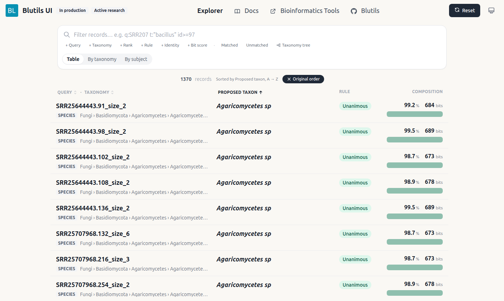

## Filtering

The search box filters the records in every view, and the filter is kept when
you switch views. Type free text to match the query, the proposed taxon or the
lineage, or use tokens:

| Token | Keeps records whose… |
|---|---|
| `q:<text>` | query contains the text |
| `t:<text>` | lineage contains the text (quotes allow spaces: `t:"bacillus subtilis group"`) |
| `rank:<rank>` | reached rank is the given one |
| `rule:<word>` | rule is the given one (`unanimous`, `majority`, `ambiguous`, `unresolved`) |
| `id>=97`, `id<90` | identity matches the comparison |
| `bits>=500` | bit score matches the comparison |
| `has:match` / `no:match` | have / do not have a significant match |

Press **Enter** to turn what you typed into filter chips. Remove a chip with its
**×**, or remove them all with **Clear filters**. The buttons below the box
insert a token for you. After `q:`, `t:`, `rank:` or `rule:`, the box suggests
the values found in your result, with how many records have each one.

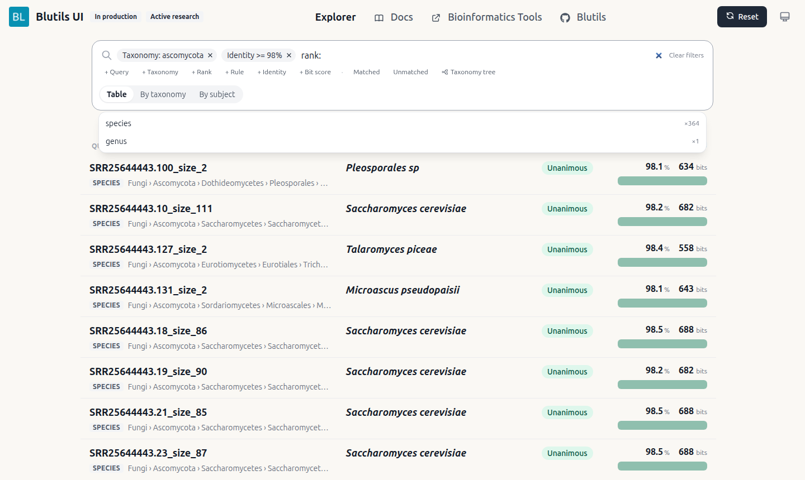

**Taxonomy tree** opens the lineages of the result as a tree. Expand the
levels with the arrows, and click a name to keep only the records under it.

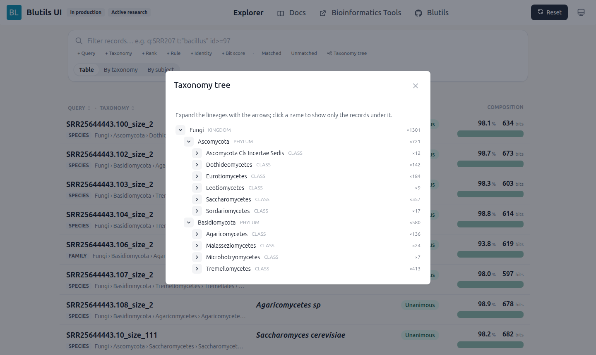

## Views

The selector under the filter buttons switches between three views. In the two
grouped views, **List / Charts** switches between the records of one group at a
time and charts of all the groups (see the Charts section below).

### Table

All the records in one list, as described above.

### By taxonomy

The records are grouped by proposed taxon. The table of contents on the left
lists every group with its size. Move between groups with the arrows on the
sides of the list (or below it on small screens), or with the **←** and **→**
keys; the matching arrow pulses on every move.

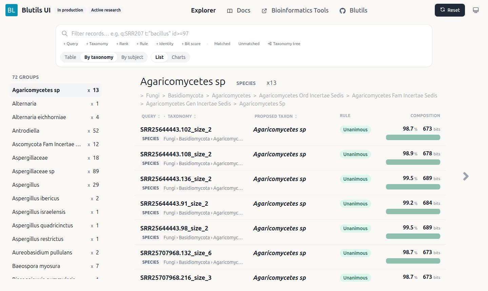

### By subject

The records are grouped by query. **Group by prefix** splits each query at a
*wrap character* and groups the records by the part before it. For example,
with `.`, `SRR25644443.100_size_2` is grouped under `SRR25644443`, which puts
all the reads of a sample together.

The viewer suggests the characters that actually group your queries, with the
number of groups each would create. A Before/After example shows the effect on
one of your queries. You can also type any character and press **Enter**.

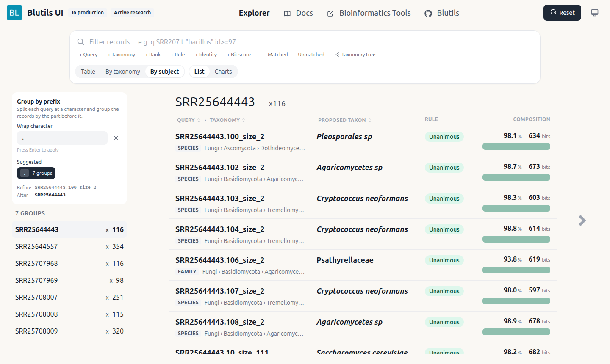

## Charts

In **By taxonomy** and **By subject**, switch **List / Charts** to **Charts** to
see every group at once. Each chart counts **Records** (one per query) or
**Reads**: dereplicated query names such as `SRR25644443.1_size_659` carry the
number of reads behind them, so Reads shows the real abundance. Where a chart
aggregates by rank, a **Rank** selector picks the level (domain to species).
Every bar, segment and cell shows its value on hover or keyboard focus, and the
filter applies to the charts too.

By taxonomy offers three charts:

- **Abundance**: one bar per taxon at the chosen rank, largest first. Click a
  bar to open that group's records.
- **Lineage**: a sunburst of the lineages, from the root outwards. Click a ring
  to zoom in, use the breadcrumb to zoom out, and **Filter by …** to keep only
  that lineage.
- **Confidence**: for the largest groups, the spread of identities (quartiles,
  median and range) next to the mix of rules.

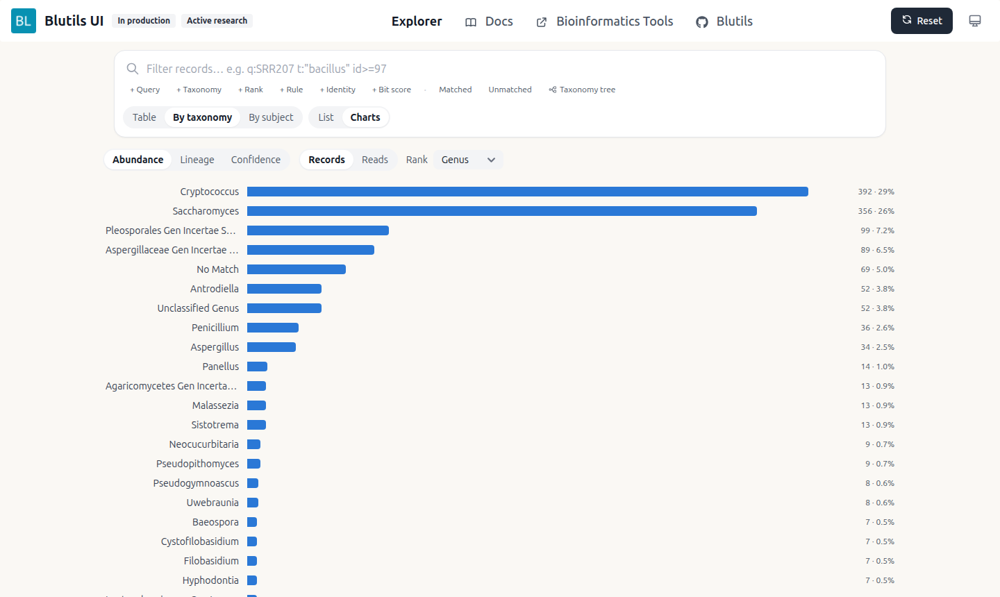

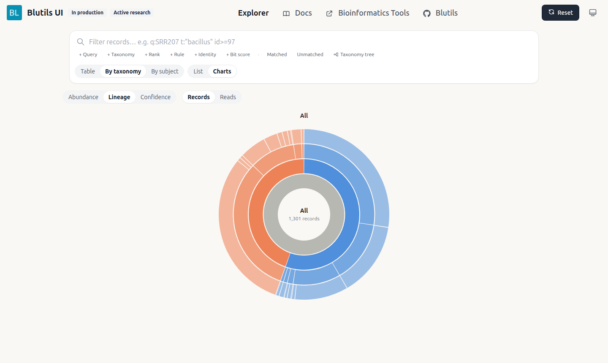

By subject offers three more, which follow the wrap character:

- **Composition**: one 100% bar per subject with the most abundant taxa in
  fixed colors, the classic relative-abundance plot to compare samples.
- **Heatmap**: subjects × the top taxa, shaded by their share in each subject.
- **Summary**: records, reads, matched share, mean identity and the rule mix of
  each subject.

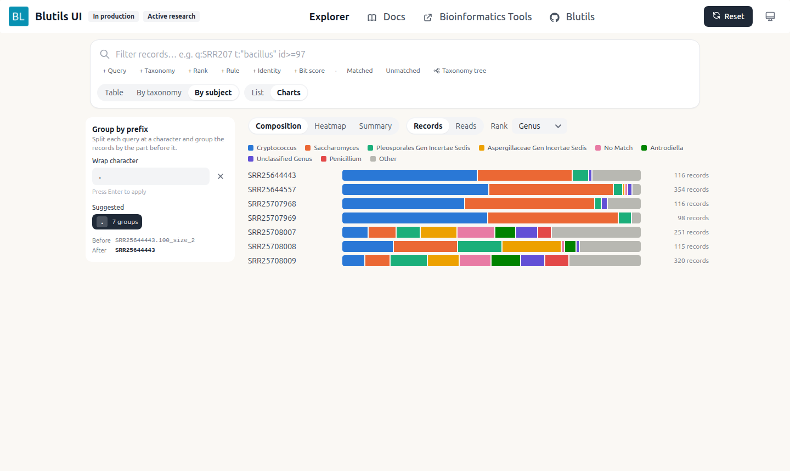

## Rules

The rule tells how the most probable taxon was picked among the consensus
beans. Click the rule of any record to open this explanation:

- **Unanimous**: there is only one consensus bean.
- **Majority**: the most frequent bean has at least twice the occurrences of
  the runner-up.
- **Ambiguous**: several beans compete and none reaches twice the runner-up.
- **Unresolved**: the record has no consensus beans.

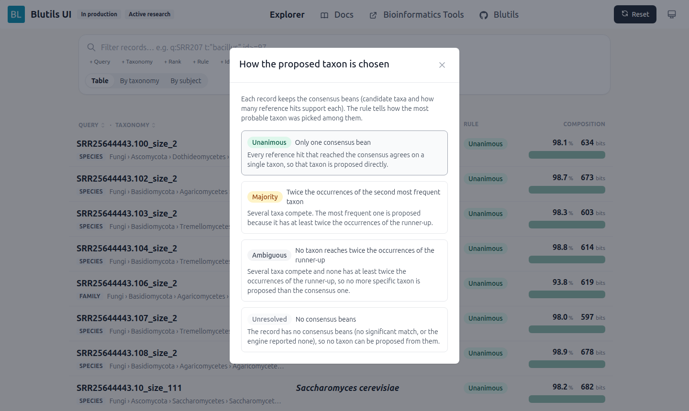

## Record details

Click anywhere on a record (except its rule), or press **Enter** on the
highlighted one, to open its details. **Esc** or a click outside closes them.

It shows:

- the proposed taxon and the composition;
- the lineage, one rank per line;
- the details of the classification (reached and maximum allowed rank, single
  match, mutated);
- the rule, followed by every consensus bean with its occurrences and the
  accessions of the reference sequences that support it.

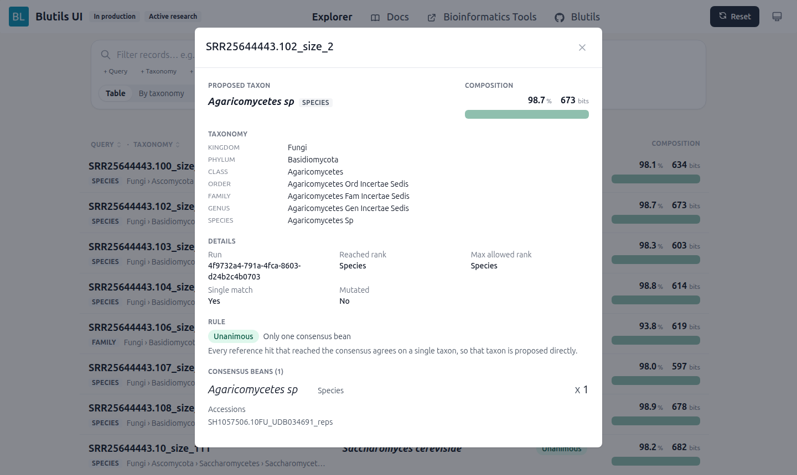

## Theme

The viewer follows your system's light or dark theme. The button at the top
right cycles between **System**, **Light** and **Dark**.

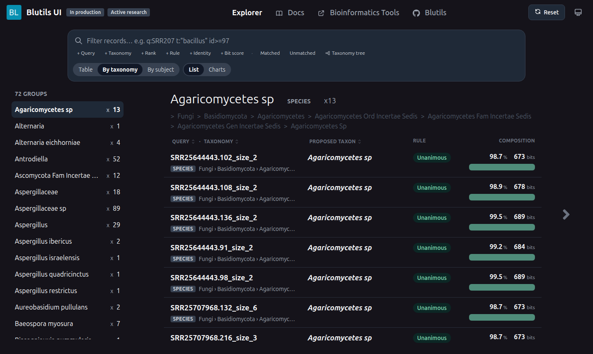
